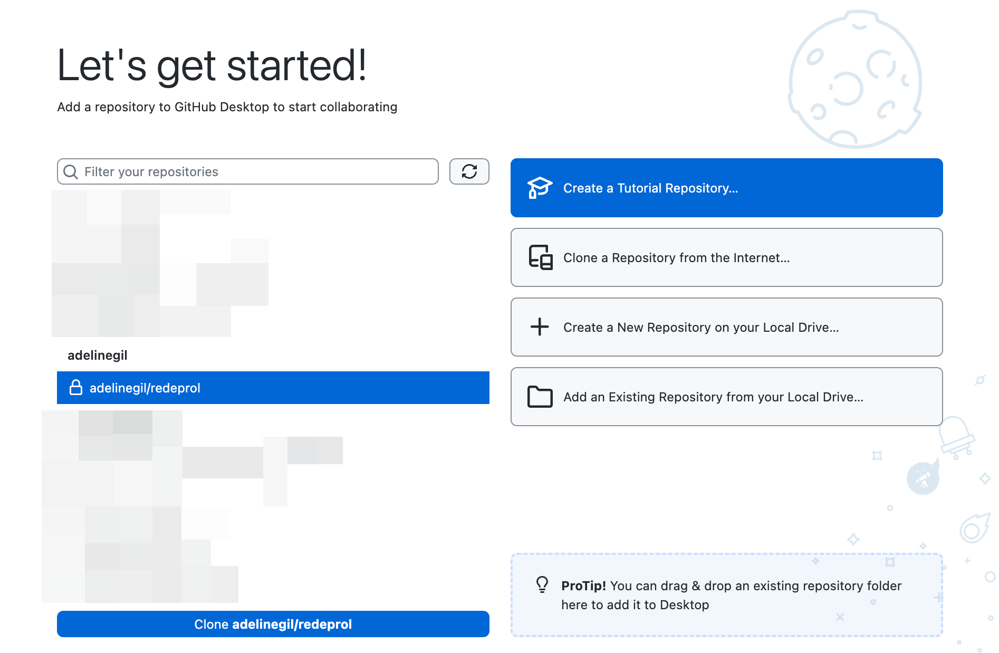

As seguintes ferramentas são recomendadas para trabalhar com o projeto da plataforma **Redeprol**:

- Um editor de texto como [VS Code](https://code.visualstudio.com/download?_exp_download=fb315fc982) ou [Zed](https://zed.dev)
- A extensão do Astro para o editor de sua escolha ([VS Code](https://marketplace.visualstudio.com/items?itemName=astro-build.astro-vscode), [Zed](https://zed.dev/extensions/astro)).
- O _runtime_ de JavaScript [Node.js](https://nodejs.org/en/download).
- O [cliente desktop do GitHub](https://desktop.github.com/download/), ou a [CLI do GitHub](https://cli.github.com).

## Clonar o projeto

Como se autenticar com o GitHub e clonar o projeto do repositório para o seu computador, permitindo desenvolvimento local.

### Com cliente desktop do GitHub

1. Certifique-se de que possui uma conta no GitHub com acesso ao repositório **Redeprol**.
2. Abra o programa **GitHub Desktop** e clique no botão "_Sign in to GitHub.com"_ para se autenticar.
3. Selecione o repositório `adelinegil/redeprol` na lista e acione o botão "_Clone adelinegil/redeprol_".
4. Escolha a pasta local onde deseja baixar o código e clique em "_Clone_" para finalizar.

| |
| --- |
|  |


### Com a CLI do GitHub

1. Rode o comando `gh auth login` para se autenticar.
2. No terminal, navegue até a pasta onde deseja baixar o código.
3. Rode o comando `gh repo clone adelinegil/redeprol` para clonar o respositório.


## Instalar dependências

Antes de começar a trabalhar com o projeto, é necessário instalar as dependências. Para isso, rode no terminal o comando:
```
npm install
```

As dependências serão baixadas e instaladas na pasta `node_modules`.
